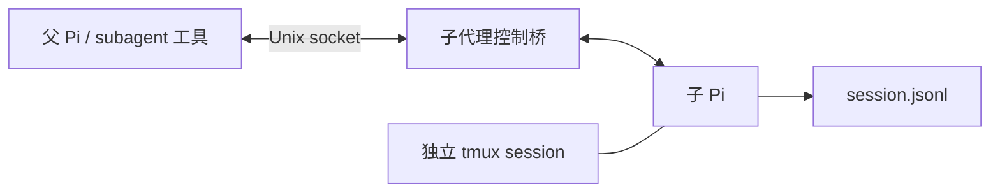
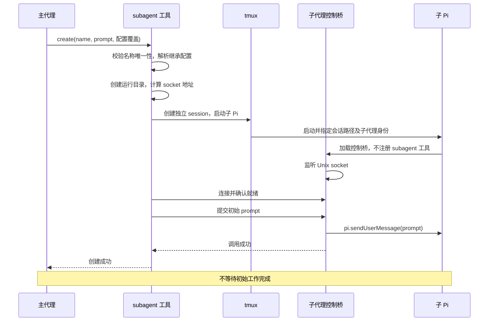
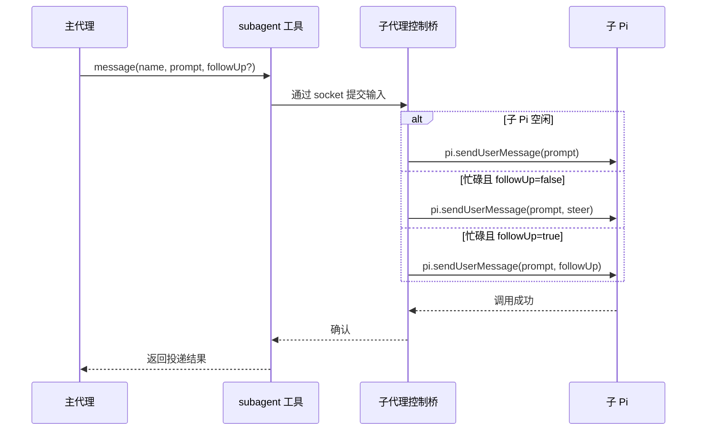
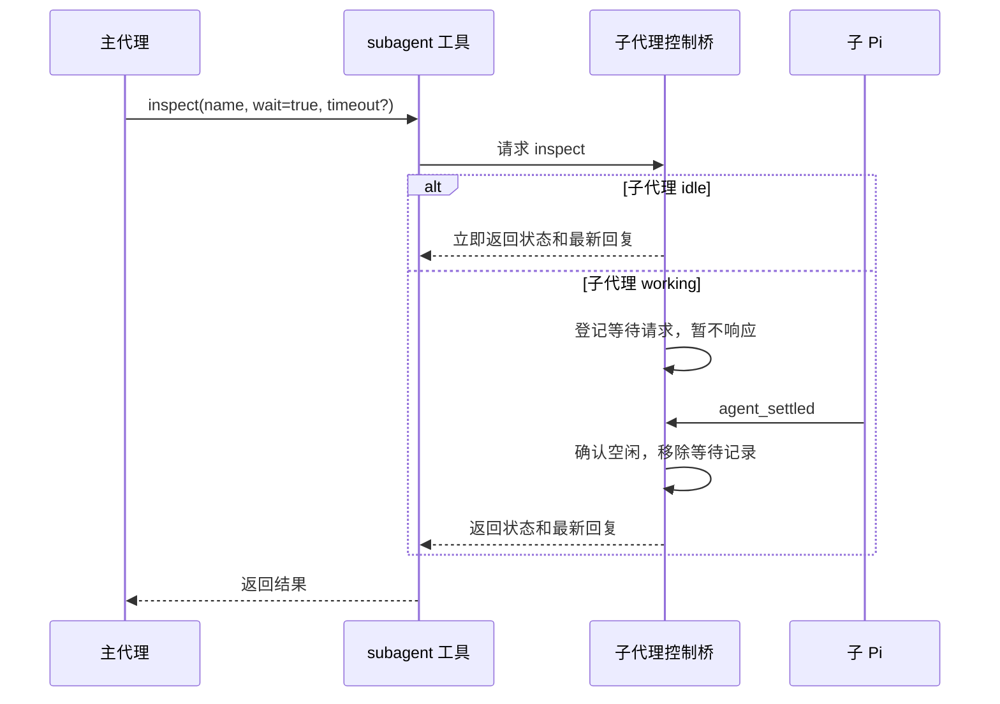
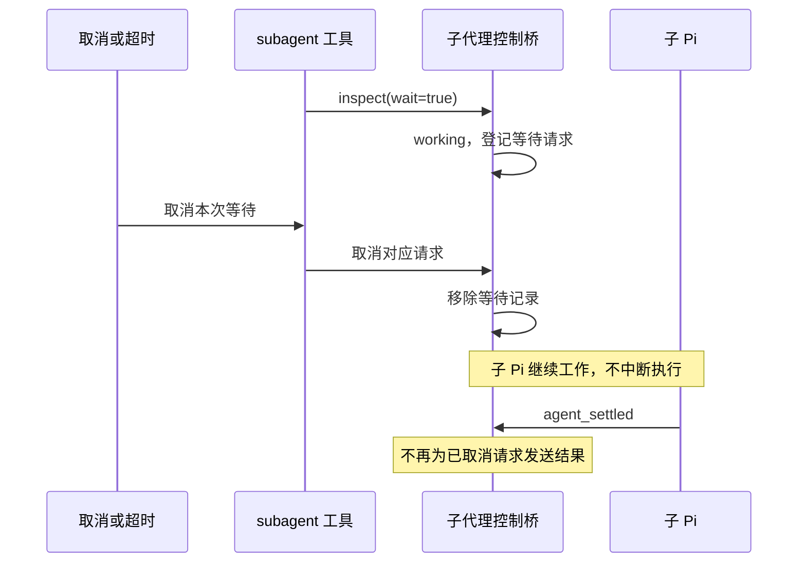
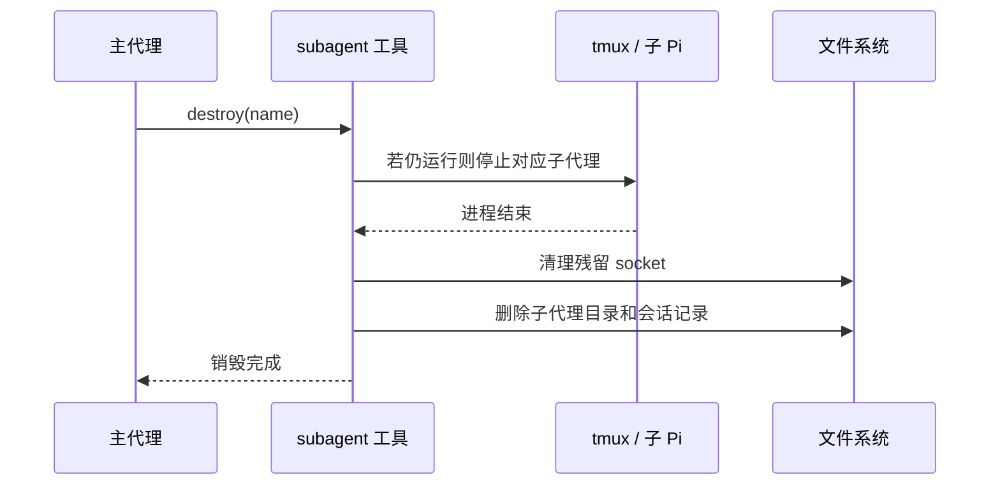
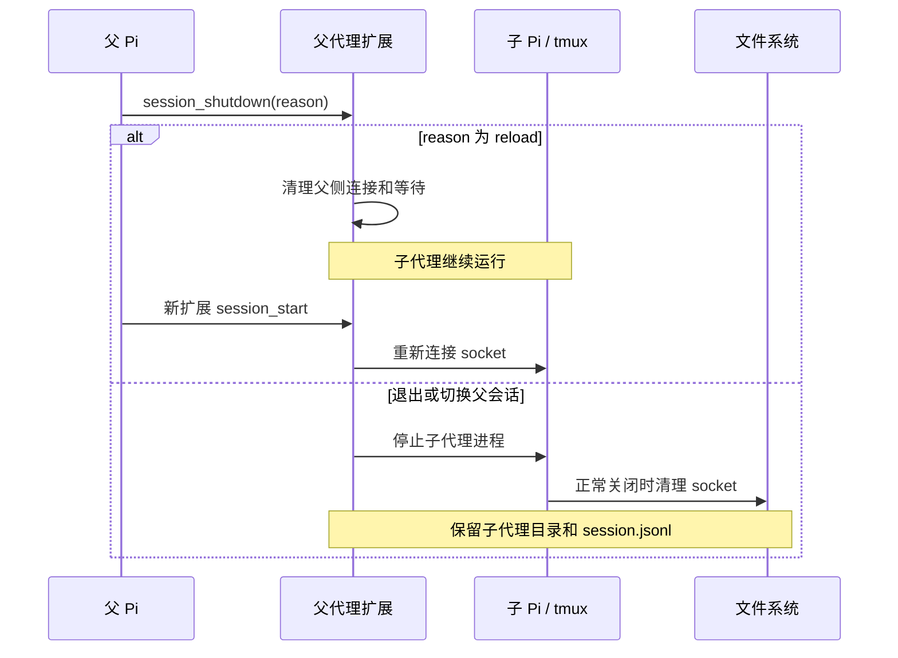
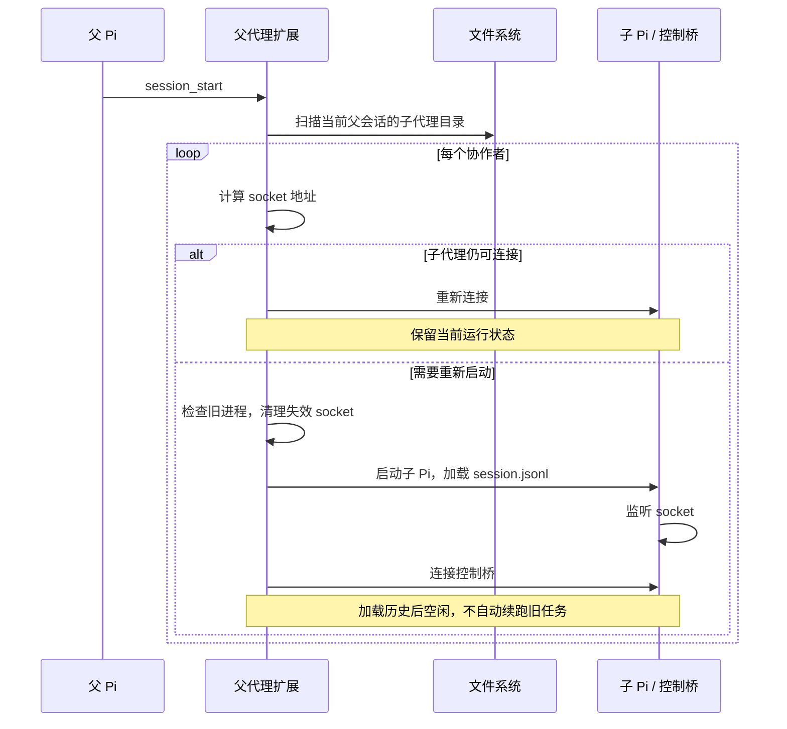
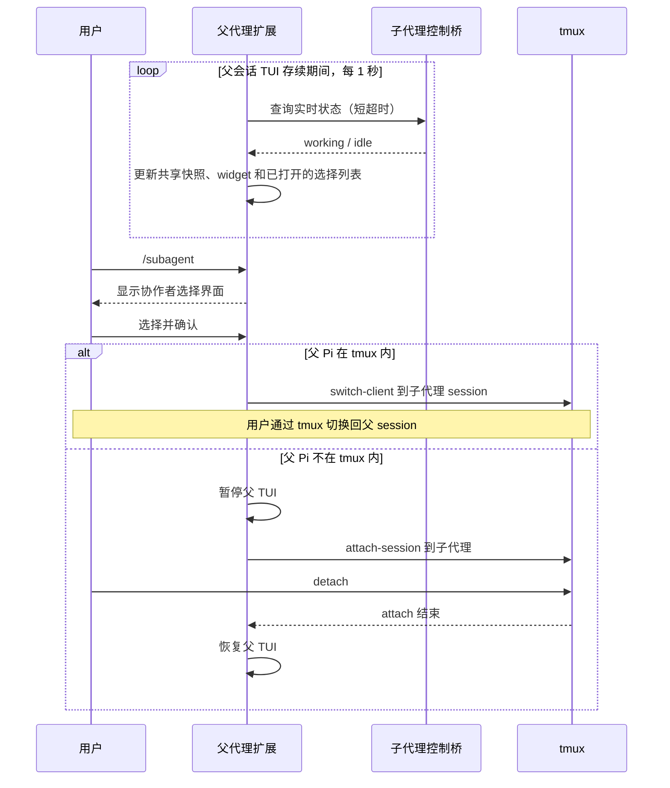

# 协作式子代理设计

## 1. 目标与范围

基于独立 tmux session 运行完整的 Pi 子代理。子代理拥有独立上下文，可持续接收任务和反馈；一次工作完成后保持空闲，不自动销毁。

主代理通过一个专用的 `subagent` 工具使用协作者，不依赖独立 CLI 或 bash 命令。子代理禁止通过本扩展嵌套创建子代理。

本文记录已确认的机器协作核心与人工入口：常驻状态 widget，以及通过 `/subagent` 选择进入子 Pi。工具调用在父 Pi 会话中的展示方式见第 10 节。

## 2. 组成与职责

- **父代理扩展**：注册 `subagent` 工具，管理启动、连接、暂停、恢复与销毁。
- **子代理控制桥**：监听 Unix socket，调用子 Pi API，维护工作状态，处理查看与等待请求。
- **Pi**：管理对话历史、工具执行、steer、follow-up 和自动处理流程。
- **tmux**：每个子代理一个独立 session，承载交互式子 Pi，不承担消息协议。
- **文件系统**：目录表达协作关系，`session.jsonl` 保存 Pi 会话。



## 3. 身份与创建配置

### 3.1 名称

- `name` 是子代理的唯一标识，同一父会话内唯一；不同父会话可以重名。
- 不生成额外的子代理业务 ID。
- 同名创建不得覆盖已有协作者。
- 名称映射到目录时必须避免路径穿越，具体校验或编码方式在实现时确定。
- 协议可以有内部请求编号，用于匹配响应和取消请求；它不是子代理标识。

### 3.2 配置继承

创建时 `name`、`prompt` 必填；`provider`、`model`、`thinking`、`cwd` 可选，未指定项继承父代理创建时的当前值。父代理之后修改配置不会自动同步给已有子代理。

子代理正常使用 Pi 的扩展、技能、项目指令等资源发现机制，不增加隔离开关或额外筛选。

创建时解析后的配置交给 Pi；恢复使用 Pi 会话加载机制，不由扩展额外保存一份配置。

### 3.3 禁止嵌套

启动子 Pi 时通过专用环境变量传入子代理运行目录（例如 `PI_SUBAGENT_RUN_DIR`）。本扩展据此区分角色：

- 父代理：注册 `subagent` 工具，管理协作者。
- 子代理：不注册 `subagent` 工具，只提供控制桥。

这是本扩展的能力边界，不是安全沙箱，不限制 bash 自行启动其他进程。

## 4. 工具接口

注册单一工具 `subagent`，通过操作字段区分以下四种操作。具体 schema 字段名和返回结构在实现时确定。

| 操作 | 参数 | 行为 |
| --- | --- | --- |
| `create` | `name, prompt, provider?, model?, thinking?, cwd?` | 创建协作者并提交初始任务 |
| `message` | `name, prompt, followUp?` | 向已有协作者提交输入 |
| `inspect` | `name?, wait?, timeout?` | 列表、查看或等待工作结束 |
| `destroy` | `name` | 停止进程并删除全部运行记录 |

### 4.1 create

创建独立 tmux session 和子 Pi，等待控制桥可用，提交初始 prompt。返回创建与投递结果，不等待工作完成。

初始 prompt 的提交确认仅表示 `pi.sendUserMessage()` 调用已发起，不保证 Pi 已接受、排队或执行，不要求可靠投递。此确认不等于初始会话已落盘；创建成功时仍须满足第 12 节的可恢复会话要求，不等待首次 assistant 回复或工作完成。



### 4.2 message

`followUp` 默认 `false`：

- 空闲：调用 `pi.sendUserMessage(prompt)`，开始新工作。
- 忙碌且 `followUp=false`：使用 `deliverAs: steer`。
- 忙碌且 `followUp=true`：使用 `deliverAs: followUp`。

调用已发起后返回，不等待消息接受、排队、落盘或工作完成。确认只表示控制桥已调用 `pi.sendUserMessage()`，不保证可靠投递；Pi 内部异步错误不由这次调用的返回值确认。不自行实现接受确认、重投、消息队列，不增加投递中的元状态、失败状态回滚、工作版本号等机制。消息调度由 Pi 完成。



### 4.3 inspect

- 不指定 `name`：列出当前父会话的协作者及概览状态。
- 指定 `name` 且 `wait=false`：立即仅返回状态，不附带 assistant 回复。
- 指定 `name` 且 `wait=true`：返回空闲状态及最新 assistant 回复；请求时已经 idle 则立即返回。
- `wait=true` 必须指定 `name`。
- `timeout` 单位为秒，只用于等待，默认 **1800 秒**，与参考实现一致。
- 结果来自 Pi 会话，不抓取 tmux 屏幕。

等待采用最简单的语义：idle 立即返回；working 登记本次请求，等待 `agent_settled` 后返回。暂不为 message 后紧接 inspect 的极短时序窗口增加额外记账。



#### 取消与超时

取消或超时只结束本次 inspect，不停止子代理，不调用其 abort，不清空 steer 或 follow-up。

子侧必须移除对应等待记录，之后 `agent_settled` 不再为该请求生成响应。连接断开时也清理该连接所属的等待请求。取消和完成同时发生时，按请求已完成或已取消处理，不重复响应。



连接断开或子代理停止不能当作成功完成；父侧应结束等待并明确报告中断或连接错误。

### 4.4 destroy

停止子 Pi 及对应 tmux session，清理 socket，删除整个子代理运行目录，包括 `session.jsonl`。不归档、不保留历史。已停止但仍有记录的协作者也可以销毁。



## 5. 工作状态

子代理在线时仅维护两个工作状态，不写入文件：

- **working**：Pi 正在工作，可能包含 steer、follow-up、重试或其他自动处理。
- **idle**：所有自动处理已结束，等待新的输入。

控制桥依据 Pi 生命周期和实际运行时状态维护：`agent_start` 表示开始工作；`agent_settled` 且确认空闲表示收尾。不得用一次 `agent_end` 作为整轮完成依据。

启动中、已停止、连接失败或进程意外退出属于父侧管理信息，不作为第三种子代理工作状态。不能以旧文件状态或 socket 文件存在来冒充在线状态。

工作结束不等于任务成功：idle 与最近回复中的错误、中止等结果信息应区分。

## 6. 持久化

```text
<agent-dir>/subagents/<parent-session>/<name>/
└── session.jsonl
```

- 父会话归属与名称由目录结构表达。
- 目录存在表示协作关系仍然存在；不另存 `suspended` 标志。
- `session.jsonl` 保存 Pi 历史与恢复所需的会话信息。
- 不创建 `metadata.json`、inbox、回复副本或工作状态文件。
- 不持久化 PID、连接、等待请求或内部请求编号。

持久化目标仅为停止后重新加载协作者，不恢复执行现场。正在运行的工具、尚未写入会话的内存排队消息、等待中的 inspect 请求不保证跨进程重启保留。

## 7. Unix socket

### 7.1 地址

优先使用有效的 `XDG_RUNTIME_DIR`：

```text
$XDG_RUNTIME_DIR/pi-subagent/<hash>.sock
```

没有有效运行时目录时回退到：

```text
/tmp/pi-subagent-<uid>/<hash>.sock
```

`hash` 为子代理运行目录绝对路径的 SHA-256，取前 32 个十六进制字符。父子使用相同规则，地址无需持久化。哈希是路径编码，不是额外业务 ID。

运行时目录仅当前用户可访问，权限为 `0700`。固定的是文件名长度，完整路径仍需检查平台长度限制；Linux 文件系统 Unix socket 路径通常最多 107 字节。当前环境 `/run/user/1000/pi-subagent/<hash>.sock` 为 64 字节。

### 7.2 生命周期与协议职责

- 子代理控制桥监听，父代理连接。
- 正常停止时关闭监听并清理 socket；恢复时重新监听。
- 异常退出可能留下 socket 文件；确认无人监听后才可清理。
- socket 文件存在不代表进程存活。
- 父扩展重载只需重新连接，不必重启子代理。
- 请求/响应、取消和连接关闭处理采用最小协议；不引入通用消息总线。
- inspect 的等待通知是原 socket 请求的延迟响应，不需子代理反向连接父代理。

## 8. 父会话生命周期

### 8.1 正常退出、切换与重载

- 父 Pi 正常退出或切换会话：停止该父会话的子代理，保留目录与会话。
- 父扩展 `/reload`：清理旧父侧连接和等待请求，不停止子代理。
- 清理应可重复执行，不误删其他父会话的协作者。



### 8.2 恢复

恢复父会话时扫描其子代理目录。若已有可连接的子代理则重新连接；否则检查旧进程与残留 socket，再从对应会话启动子 Pi。

重新启动的子代理加载历史，以空闲状态等待新消息，不自动续跑被中断的任务。不保存原来的 inspect 等待请求。



强制杀死父进程或系统崩溃不保证执行退出清理；恢复时必须避免重复启动仍存活的子代理。

## 9. 人工交互

父 Pi 的交互式 TUI 提供常驻状态 widget 和 `/subagent` 选择入口。UI 与工具执行逻辑分离，非 TUI 模式不创建这些界面或 UI 刷新定时器，不影响 subagent 工具正常工作。

### 9.1 常驻状态 widget

- 在编辑器下方显示当前父会话的协作者名称及状态，例如 `subagents: reviewer:working | implementer:idle`。
- 没有协作者时隐藏；数量多时紧凑展示部分条目与剩余数量，具体布局在实现时确定。
- 每 **1 秒**通过 Unix socket 查询状态；这是本地通信，不触发模型调用。
- 单个子代理不可连接时注明不可用，不阻塞其他条目的更新。
- 查询设短超时；上一轮刷新未结束时不叠加下一轮。
- 父会话启动时启用刷新，退出、切换或重载时清理定时器、UI 连接和 widget，避免重复刷新或使用旧上下文。
- UI 状态快照不持久化，不作为工具 inspect 的权威来源。

### 9.2 `/subagent` 选择进入

- 列出当前父会话的协作者，显示名称、状态等概览信息。
- 选择界面显式使用 Pi 的 `DynamicBorder` 绘制顶部和底部边框，颜色使用主题的 `accent`，与参考实现的风格保持一致。
- 布局顺序为：顶部边框、标题、空行、列表、空行、键盘提示、底部边框。顶部边框与标题之间、键盘提示与底部边框之间不添加空行。
- 状态刷新、终端缩放和空列表时保持上述边框与间距；所有行按可用终端列宽渲染或截断，包括极窄宽度。
- 与常驻 widget 共用状态快照和同一个刷新器，不单独轮询。
- 刷新列表时保留当前选择，不因状态更新跳动。
- 支持键盘选择、确认与取消；不将鼠标点击作为必需交互。
- 选中可进入的子代理后关闭选择界面，进入其完整 Pi TUI。
- 父 Pi 已在 tmux 中：使用 `switch-client` 切换到子代理 session；用户通过 tmux 的 session 切换功能返回父 session。
- 父 Pi 不在 tmux 中：暂停父 TUI，执行 `attach-session`；detach 后恢复父 TUI。
- 不可用条目不得误进入；进入失败时报告错误并保持或恢复父 TUI。



UI 状态刷新不改变 `inspect(wait=true)` 的事件驱动等待机制；本阶段不增加 socket 状态订阅协议。

## 10. 工具调用展示

### 10.1 通用规则

- 工具卡片的标题、状态和提示使用英文；输入 prompt 和子代理回复保持原文，不翻译。
- 调用标题以 `subagent 操作 名称`（如 `subagent create reviewer`）展示。仅工具名 `subagent` 加粗，操作名保持普通字重，两者使用 `toolTitle` 主题色；子代理名称仅用空格分隔，使用普通文本样式，不加粗、不使用 accent 高亮，不添加圆点或文件链接。`follow-up` 等参数保持普通字重。调用中与结果卡片使用相同标题样式。
- create 不在标题中额外展示可选配置，沿用 cwd 行与底部配置结果。message 仅在 `followUp=true` 时附加 `(follow-up)`；inspect 仅在 `wait=true` 时附加 `(wait, timeout XXs)`，XX 为有效超时秒数，省略 timeout 时显示默认 1800。false 或未启用时不显示标签。括号及其中的参数使用 `muted` 主题色、保持普通字重，与内置 bash 工具的 timeout 后缀样式一致。
- 调用信息与执行结果之间使用空行分隔。
- 成功结果使用 `✓`，错误和等待超时使用 `✗`。
- `working`、`idle` 不加成功标记：工作空闲不代表任务成功。
- 用户主动取消等待不视为执行错误，不加 `✗`。
- 默认紧凑展示，长 prompt 显示摘要，展开查看完整内容。回复使用 Markdown 渲染，默认限制高度，展开查看完整内容。
- 展示层不得把消息投递成功表达为任务完成，也不得掩盖回复中的错误或中止信息。

### 10.2 create

调用中保留任务摘要与实际生效的 cwd（包括继承值），底部显示 `Creating...`：

```text
subagent create reviewer
  Review the current changes, focusing on error handling.
  cwd: /home/huxeon/workspaces/pi-subagent

Creating...
```

成功后只替换底部状态，其他内容保持不变。底部使用实际生效的 provider、model、thinking：

```text
subagent create reviewer
  Review the current changes, focusing on error handling.
  cwd: /home/huxeon/workspaces/pi-subagent

✓ Created · provider/model:thinking
```

展开后可查看完整 prompt；不额外列出 provider、model、thinking，它们已在底部结果中展示。cwd 行保持不变。

### 10.3 message

不根据运行时状态显示 `prompt` 或 `steer`；仅在 `followUp=true` 时在调用行显示 `(follow-up)`，false 或省略时不显示。调用已发起后底部统一显示 `✓ Delivered`，不区分 Delivered / Queued。这里的 `Delivered` 仅表示已调用 Pi 输入 API，不是消息已接受、排队、落盘或任务完成的保证。

```text
subagent message reviewer
  Also check cancellation handling.

✓ Delivered
```

```text
subagent message reviewer (follow-up)
  Summarize the findings after finishing the review.

✓ Delivered
```

### 10.4 inspect

不指定 name，列表结果与调用行空一行：

```text
subagent inspect

reviewer       working
implementer    idle
```

指定 name 且不等待，仅显示状态，不附带最新回复：

```text
subagent inspect reviewer

working
```

等待期间：

```text
subagent inspect reviewer (wait, timeout 1800s)

Waiting for completion...
```

等待完成（或 wait=true 请求时已经 idle）后，不再展示工作状态，调用行与回复用空行分隔。仅调整工具卡片展示，不改变协议中的状态信息：

```text
subagent inspect reviewer (wait, timeout 1800s)

Found two issues:
1. …
2. …
```

### 10.5 destroy

调用中：

```text
subagent destroy reviewer

Destroying...
```

成功后：

```text
subagent destroy reviewer

✓ Destroyed · session data deleted
```

### 10.6 错误、超时与取消

错误结果与调用信息用空行分隔，底部以 `✗` 开头，例如：

```text
subagent create reviewer

✗ A subagent named "reviewer" already exists.
```

```text
subagent inspect reviewer

✗ Connection lost. Subagent status is unknown.
```

等待超时：

```text
subagent inspect reviewer (wait, timeout 1800s)

✗ Wait timed out after 1800s. Subagent continues running.
```

主动取消等待：

```text
subagent inspect reviewer (wait, timeout 1800s)

Wait cancelled. Subagent continues running.
```

超时和取消提示中的继续运行指取消等待不会停止子代理，不将其工作结果标为成功或失败；已知连接断开或子进程退出时应报告对应事实。

## 11. 非目标

- 独立 subagent CLI。
- 嵌套子代理。
- worktree 或操作系统级隔离。
- 独立的 steer / follow-up 调度器。
- 持久化消息队列、任务版本号、执行现场恢复。
- 自动重放中断任务。
- 改名、历史归档或额外配置隔离开关。
- 除状态 widget 和选择进入之外的人工管理界面。

## 12. 实现前需验证的细节

以下是实现验证点，不应未经验证就扩展持久化格式或引入额外机制：

1. Pi 初始会话的落盘时机：创建成功时必须已有足以恢复的会话，不能假定空文件能恢复配置。
2. Pi 从会话恢复 provider、model、thinking、cwd 的具体行为，以及恢复所需的 CLI 参数。
3. 控制桥必须在子 Pi 中可靠加载，同时保持正常资源发现行为。
4. `agent_settled`、空闲判断及最新 assistant 回复获取的实际 API 用法。
5. 正常停止 Pi/tmux 时的会话落盘与 socket 清理行为。
6. 协议分帧、请求取消、超时、错误结构和工具输出大小限制。
7. 名称校验或编码、运行目录规范化、tmux 名称派生与启动失败清理。

若验证发现现有假设不成立，应先讨论调整，不静默增加 metadata、任务队列或改变恢复语义。
